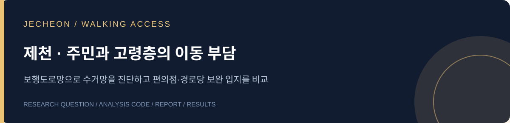

# 제천시 폐의약품 수거망 보완 입지 분석

수거지를 추가할 때 어떤 주민의 이동 부담이 줄어드는지 살펴봤습니다. 기존 수거망을 유지하면서 편의점과 경로당을 후보로 두고, 도로를 따라 이동하는 거리를 기준으로 입지를 비교합니다.

**[최종 보고서](reports/jecheon_report.pdf) · [사용한 코드](code/) · [대안별 결과](results/) · [데이터 준비](docs/DATA.md)**

## 추가 거점 10곳의 비교

| 대안 | 전체 주민 평균 편도거리 | 고령층 평균 편도거리 |
|---|---:|---:|
| 기존망 | 1,437.9m | 1,267.7m |
| 편의점안 | 962.2m | 990.6m |
| 편의점·경로당 혼합 효율안 | 945.0m | 935.8m |
| 혼합 고령층 우선안 | 963.6m | 896.5m |

전체 주민의 거리 감소를 우선하는 대안과 고령층을 우선하는 대안의 선정 시설이 달라집니다. 5·10·15·20곳, 세 가지 입지 방향으로 총 12개 대안을 계산했습니다.

## 어떻게 계산했나

1. 전체 주민: 인구가 공개된 100m 격자의 중심점을 출발점으로 설정
2. 고령층: 집계구의 주민 분포를 반영한 대표점에 65세 이상 인구 연결
3. 보행거리: 출발점과 시설을 80m 이내 도로에 연결하고 최단경로와 연결거리 합산
4. 입지 선정: 기존 시설을 유지하며 인구를 반영한 평균 접근거리 최소화

전체 주민 비교 대상은 5,309개 격자의 132,709명입니다. 공개 인구 중 경로를 계산하지 못한 7,186명은 별도로 집계했습니다. 고령층은 269개 집계구, 공개 통계의 하한 인구 32,786명을 사용했습니다. 두 집단은 위치 표현 단위가 다릅니다.

이 결과는 보행도로망 기반의 접근성 추정치입니다. 실제 시설 참여와 출입구, 통행 가능 구간은 도입 과정에서 확인할 항목입니다.

## 자료 구성

분석 코드는 `code/`, 제출 보고서는 `reports/`, 저장된 집계와 선정 명부는 `results/`에 있습니다. [실행 순서](code/README.md)

팀: **모두의 거점**. 김종윤·김한그루.
